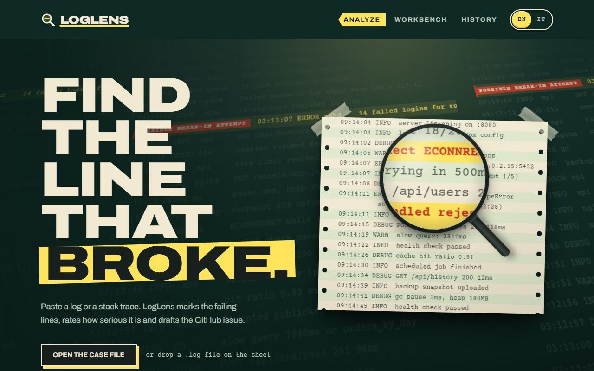
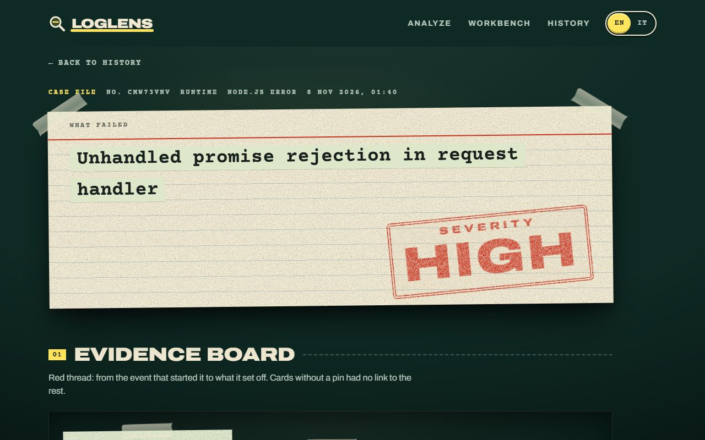
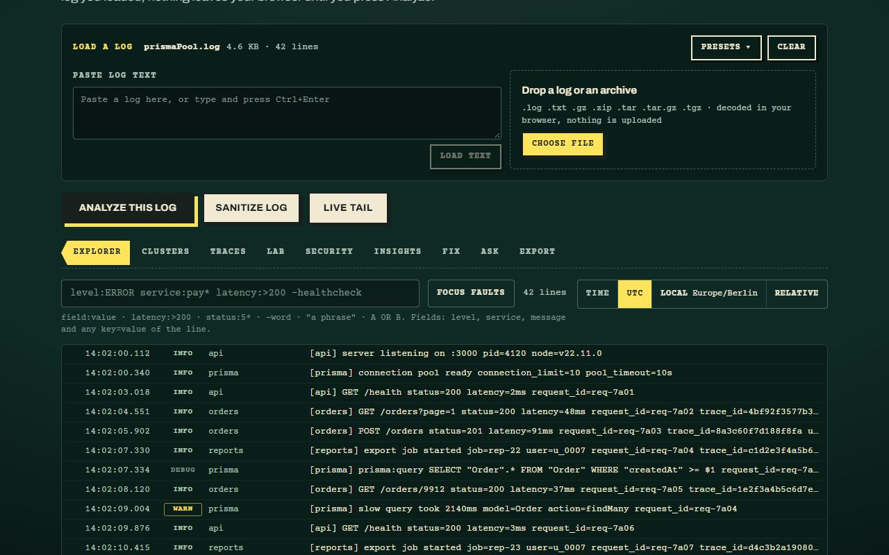
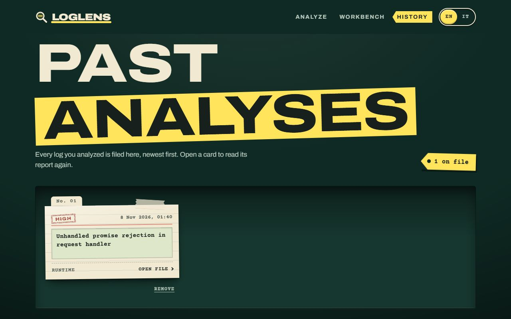
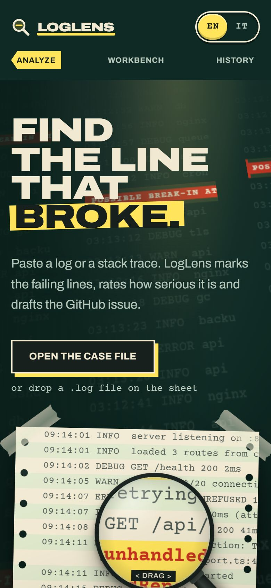
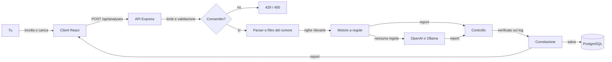

<div align="center">


# LogLens

**Trova la riga che ha ceduto.**

Incolla un log o uno stack trace. LogLens segna le righe che falliscono, valuta quanto è grave il
problema, spiega le cause probabili e prepara la issue GitHub, pronta da copiare.

[**Demo online**](https://loglens-demo.vercel.app) ·
[English](./README.md) ·
[Architettura](./docs/architecture.md) ·
[Changelog](./docs/changelog.md)

[](https://github.com/jacknegri89/LogLens/actions/workflows/ci.yml)
[](./LICENSE)




</div>

## Indice

- [Cosa fa](#cosa-fa)
- [Come si presenta](#come-si-presenta)
- [Come funziona](#come-funziona)
- [Avvio rapido](#avvio-rapido)
- [Configurazione](#configurazione)
- [API](#api)
- [Struttura del progetto](#struttura-del-progetto)
- [Controlli di qualità](#controlli-di-qualità)
- [Pubblicazione su Vercel](#pubblicazione-su-vercel)
- [Sicurezza e privacy](#sicurezza-e-privacy)
- [Stato e limiti](#stato-e-limiti)
- [Documentazione](#documentazione)
- [Licenza](#licenza)

## Cosa fa

LogLens trasforma un muro di testo di log in una risposta su cui puoi agire.

**Analisi**

- Incolla un log o uno stack trace, oppure trascina un file `.txt` / `.log`. Il formato viene riconosciuto da solo: syslog, JSON lines, errori Node.js, traceback Python, stack trace Java, Docker e Kubernetes, PostgreSQL, log di accesso nginx e Apache, eventi Windows.
- Il rumore di routine (health check, probe, file statici) viene tolto prima dell'analisi, così i guasti veri risaltano.
- Ogni problema riceve una **gravità** (da informativa a critica) e una **categoria**, con **cause** probabili e **passi di debug**.
- Gli eventi collegati vengono uniti: prima la causa radice, poi ciò che ha scatenato, in ordine di tempo. Tanti accessi falliti da uno stesso indirizzo seguiti da uno riuscito vengono segnalati come possibile intrusione a forza bruta.
- Viene preparata una **issue GitHub** formattata, pronta da copiare.
- Un **motore a regole** integrato (più di 50 regole) funziona senza chiavi e senza rete. **OpenAI** può subentrare per i log che nessuna regola copre (`hybrid`), o per tutti. **Ollama** usa un modello locale, gratis.
- La pagina e i report parlano **inglese e italiano**.

**Conserva e condividi**

- Ogni analisi finisce in una cronologia che solo il suo proprietario può vedere, e resta per 90 giorni. Una copia resta nel browser, così la cronologia si apre anche se il server è spento.
- Condividi un report con un link segreto in sola lettura. Il log originale non è mai incluso, e il link si può revocare in ogni momento.
- Segna un report come utile o non utile.

**Workbench**: strumenti che lavorano su un log senza uscire dal tuo browser.

- **Explorer** con un piccolo linguaggio di ricerca (`level:ERROR service:pay* latency:>200 -healthcheck`), una lista virtuale che resta fluida anche con log enormi, e archivi `.gz`, `.zip` e `.tar` aperti in locale.
- **Gruppi** che riuniscono le righe simili, **Tracce** che seguono una richiesta tra più servizi.
- **Laboratorio**: un prova-regex che non può bloccare la pagina, un confronto di log, un lettore di source map e una coda in tempo reale.
- **Sicurezza**: un controllo dei pattern sospetti e uno strumento che nasconde i dati sensibili.
- **Metriche**: punteggio di rischio, flame graph e mappa dei servizi coinvolti.
- **Esporta** come issue GitHub, messaggio Slack, evento PagerDuty, post-mortem o JSON, più i permalink. Una palette di comandi (`Ctrl K`) raggiunge tutto.

## Come si presenta

<table>
  <tr>
    <td width="50%"></td>
    <td width="50%"></td>
  </tr>
  <tr>
    <td align="center"><sub><b>Il report</b>: cosa è fallito, quanto è grave e le prove.</sub></td>
    <td align="center"><sub><b>Il Workbench</b>: cerca, raggruppa e ispeziona un log nel browser.</sub></td>
  </tr>
  <tr>
    <td width="50%"></td>
    <td width="50%" align="center"></td>
  </tr>
  <tr>
    <td align="center"><sub><b>Cronologia</b>: tutte le analisi degli ultimi 90 giorni, solo tue.</sub></td>
    <td align="center"><sub><b>Su telefono</b>: le stesse pagine, disposte per uno schermo piccolo.</sub></td>
  </tr>
</table>

> Le schermate arrivano dalla demo online, che usa `AI_PROVIDER=hybrid`: rispondono prima le regole integrate, e OpenAI interviene solo sui log che nessuna regola copre.

## Come funziona



1. Il **parser** legge il log, ne riconosce il formato e tiene le righe rilevanti. Il **filtro del rumore** scarta il traffico di routine, salvo che porti un errore.
2. Il **motore a regole** riconosce i guasti noti e scrive il report. In modalità `hybrid` si interroga un modello solo se nessuna regola si applica.
3. Il **controllo** verifica ogni risposta del modello sul log: la gravità non scende sotto le prove, le righe citate devono essere righe vere, link e HTML vengono tolti, i comandi rischiosi scartati.
4. La **correlazione** collega gli eventi (causa, effetti, indirizzi in comune) e costruisce la cronologia.
5. Il report è validato con Zod, salvato con Prisma e restituito.

Il prompt, le sue quattro fasi e la difesa dal prompt injection sono descritti in [`docs/prompts.md`](./docs/prompts.md). Il progetto completo è in [`docs/architecture.md`](./docs/architecture.md).

## Avvio rapido

**Ti servono:** Node.js 20 o successivo e un database PostgreSQL (gratuito su [Neon](https://neon.tech) o [Supabase](https://supabase.com)). Una chiave OpenAI o [Ollama](https://ollama.com) sono facoltativi: il motore a regole non richiede nulla.

```bash
git clone https://github.com/jacknegri89/LogLens.git
cd LogLens
```

**Backend** (http://localhost:3001)

```bash
cd server
npm install                 # genera anche il client Prisma
cp .env.example .env        # poi inserisci DATABASE_URL e DIRECT_URL
npm run prisma:migrate      # crea le tabelle: controlla le modifiche e fai un backup se ci sono dati
npm run db:seed             # facoltativo: analisi di esempio, solo se la tabella è vuota
npm run dev                 # parte con ricarica automatica
```

```bash
curl http://localhost:3001/api/health
# { "status": "ok", "service": "loglens-server", "timestamp": "..." }
```

**Frontend** (http://localhost:5173)

```bash
cd client
npm install
npm run dev
```

Apri http://localhost:5173. Il client si aspetta l'API sulla porta 3001.

Provalo con i log in [`examples/`](./examples/): un'eccezione non gestita di Node.js, un avvio fallito di Docker Compose ed errori di connessione al database.

## Configurazione

Tutto si configura con variabili d'ambiente, validate all'avvio (un valore sbagliato ferma il server con un messaggio chiaro). In locale stanno in `server/.env`; su Vercel nelle impostazioni del progetto. I segreti non vanno mai nel codice né in git.

| Variabile                   | Predefinito                      | Cosa fa                                                                                      |
| --------------------------- | -------------------------------- | -------------------------------------------------------------------------------------------- |
| `DATABASE_URL`              | (obbligatoria)                   | Connessione PostgreSQL con pooler, usata dall'app                                            |
| `DIRECT_URL`                | (obbligatoria per le migrazioni) | Connessione diretta, usata dalla CLI di Prisma                                               |
| `AI_PROVIDER`               | `mock`                           | `mock`, `rules`, `hybrid`, `openai` oppure `ollama`                                          |
| `OPENAI_API_KEY`            |                                  | Serve per `openai` e `hybrid`                                                                |
| `OPENAI_MODEL`              | `gpt-4o-mini`                    | Il modello OpenAI                                                                            |
| `OLLAMA_BASE_URL`           | `http://localhost:11434`         | Dove ascolta Ollama                                                                          |
| `OLLAMA_MODEL`              | `llama3.2`                       | Il modello Ollama                                                                            |
| `RATE_LIMIT_PER_HOUR`       | `5`                              | Tentativi di analisi per indirizzo all'ora, anche quelli falliti (`0` = nessun limite)       |
| `GLOBAL_LIMIT_PER_HOUR`     | `100`                            | Tentativi di analisi di tutti all'ora (`0` = nessun limite)                                  |
| `API_RATE_LIMIT_PER_MINUTE` | `120`                            | Richieste al minuto da un indirizzo a tutta l'API, contate per istanza (`0` = nessun limite) |
| `TRUST_PROXY`               | `false`                          | `true` dietro un proxy come Vercel, così i limiti contano i visitatori veri                  |
| `VISITOR_SALT`              | `loglens`                        | Un testo casuale e lungo che dà il sale all'hash degli indirizzi. **Cambialo in produzione** |
| `CRON_SECRET`               |                                  | Almeno 16 caratteri; Vercel Cron lo invia per cancellare le analisi oltre i 90 giorni        |
| `CORS_ORIGIN`               | `*`                              | Origine consentita. In produzione lascialo vuoto: client e API usano lo stesso dominio       |

## API

| Metodo   | Percorso                     | Cosa fa                                                                  |
| -------- | ---------------------------- | ------------------------------------------------------------------------ |
| `POST`   | `/api/analyses`              | Analizza un log e salva il report                                        |
| `GET`    | `/api/analyses`              | La cronologia di questo visitatore                                       |
| `GET`    | `/api/analyses/:id`          | Una analisi con il report completo                                       |
| `DELETE` | `/api/analyses/:id`          | Cancella una analisi (`DELETE /api/analyses` le cancella tutte)          |
| `PUT`    | `/api/analyses/:id/feedback` | Segna utile, non utile, oppure toglie il voto                            |
| `POST`   | `/api/analyses/:id/share`    | Crea il link segreto in sola lettura (`DELETE` lo revoca)                |
| `GET`    | `/api/shared/:token`         | Il report condiviso, senza il log grezzo                                 |
| `GET`    | `/api/cron/retention`        | Cancella le analisi oltre i 90 giorni (Vercel Cron, richiede un segreto) |
| `GET`    | `/api/health`                | Controllo che il server sia vivo                                         |

Le rotte `/api/analyses` richiedono l'intestazione `X-Visitor-Id`: un id casuale che il browser conserva, non un login. Dettagli, corpi delle richieste e mappa del codice sono in [`server/README.it.md`](./server/README.it.md).

## Struttura del progetto

```text
LogLens/
├── client/               # React + TypeScript + Vite + Tailwind
│   ├── src/pages/        # analisi, cronologia, report, link condiviso, privacy
│   ├── src/content/      # tutti i testi visibili, in inglese e italiano
│   ├── src/workbench/    # il Workbench, una cartella per ogni scheda
│   └── e2e/              # test end-to-end con Playwright
├── server/               # Node.js + Express + TypeScript
│   ├── src/routes/       # le rotte /api
│   ├── src/ai/           # parser → motore a regole → OpenAI / Ollama → controllo
│   ├── src/services/     # limiti, conservazione, salvataggio delle analisi
│   └── prisma/           # schema e dati di esempio
├── docs/                 # architettura, prompt, decisioni, stato, changelog
├── examples/             # log di esempio da provare
├── vercel.json           # comando di build e cron giornaliero
└── .github/workflows/    # CI
```

## Controlli di qualità

```bash
npm run format:check                 # Prettier, dalla radice del repository
npm run typecheck --prefix server
npm run typecheck --prefix client
npm run lint --prefix client
npm test --prefix server             # test unitari
npm test --prefix client             # test unitari
npm run test:e2e --prefix client     # Playwright, schermo da telefono
```

Gli stessi controlli, più le due build, girano a ogni push in [GitHub Actions](./.github/workflows/ci.yml). Le dipendenze sono controllate con `npm audit` e tenute a zero vulnerabilità note.

## Pubblicazione su Vercel

L'intera applicazione (client React e API Express) gira come un unico progetto Vercel, con PostgreSQL su Neon tramite l'integrazione di Vercel. Entrambi hanno un piano gratuito.

1. **Importa il repository** su [vercel.com](https://vercel.com) → _Add New → Project_. Non toccare le impostazioni di build: le contiene `vercel.json`.
2. **Aggiungi il database**: in _Storage_ aggiungi **Neon**. Vercel crea `DATABASE_URL` e `DIRECT_URL`.
3. **Aggiungi le variabili d'ambiente** della sezione [Configurazione](#configurazione). Su Vercel imposta almeno `AI_PROVIDER`, `TRUST_PROXY=true`, un `VISITOR_SALT` casuale e lungo, e `CRON_SECRET`. Aggiungi `OPENAI_API_KEY` per `openai` o `hybrid`.
4. **Crea le tabelle una volta**, dal tuo computer, con gli indirizzi di Neon in `server/.env`: `cd server && npm run prisma:migrate`.
5. **Pubblica**: fai il push sul ramo collegato, oppure esegui `npm run build:vercel` e pubblica `.vercel/output`.

Vercel Cron chiama `/api/cron/retention` ogni giorno alle 03:00 UTC (vedi `vercel.json`).

Se pubblichi una tua istanza, aggiorna contatto, regione del database e fornitori in [`client/src/content/privacy.ts`](./client/src/content/privacy.ts), e tieni i 90 giorni della pagina uguali a `ANALYSIS_RETENTION_DAYS` in `server/src/services/retention.ts`.

## Sicurezza e privacy

- **Nessun cookie.** La memoria locale del browser conserva solo le tue scelte (lingua, anonimizza, tema), un identificativo casuale del visitatore e una copia locale della cronologia. La [pagina privacy](https://loglens-demo.vercel.app/privacy) elenca cosa viene trattato, perché e per quanto tempo.
- **Anonimizza prima dell'invio.** Un interruttore sostituisce indirizzi IP, e-mail e segreti nel tuo browser, prima che qualcosa esca.
- **Limiti sui dati.** Le analisi si cancellano dopo 90 giorni, o prima da te. Gli indirizzi di rete sono conservati solo come hash con sale, e i tentativi che li usano vengono rimossi dopo un'ora.
- **I link condivisi** hanno un token impossibile da indovinare, non finiscono nei log, viaggiano con `Referrer-Policy: no-referrer`, non vengono indicizzati e si possono revocare.
- **Limiti contro gli abusi.** Limiti orari per indirizzo e globali sulle analisi, e un limite al minuto su tutta l'API.
- **Risposte protette.** Una Content-Security-Policy rigorosa, `X-Frame-Options`, `nosniff`, HSTS e una Permissions-Policy chiusa su ogni risposta.
- **L'output del modello non è fidato.** Viene validato, verificato sul log da cui nasce, ripulito da link e HTML, e il prompt usa un delimitatore casuale contro il prompt injection.
- **Endpoint di pulizia.** `GET /api/cron/retention` rifiuta ogni chiamata senza `CRON_SECRET`, confrontato a tempo costante.

Anche così, non incollare segreti veri in un'istanza pubblica.

## Stato e limiti

- Le schede **Correzione** e **Chiedi** del Workbench mostrano "non ancora disponibile". Il loro codice è nel repository ma irraggiungibile finché non viene rivisto.
- Il limite di richieste al minuto è contato nella memoria di ogni istanza del server: ferma le raffiche, ma non è una quota globale. I limiti orari sulle analisi sono nel database e sono condivisi.
- La pulizia giornaliera segue la pianificazione di Vercel; le analisi oltre i 90 giorni vengono rimosse anche alla successiva lettura della cronologia o a una nuova analisi.

Vedi [`docs/stato.md`](./docs/stato.md) per lo stato attuale e [`docs/decisions.md`](./docs/decisions.md) per il perché delle scelte.

## Documentazione

| File                                             | Cosa contiene                                   |
| ------------------------------------------------ | ----------------------------------------------- |
| [`docs/architecture.md`](./docs/architecture.md) | Il flusso, i componenti e le scelte di progetto |
| [`docs/prompts.md`](./docs/prompts.md)           | Il prompt, le sue fasi e il contratto JSON      |
| [`docs/decisions.md`](./docs/decisions.md)       | Le decisioni, con motivo e alternative          |
| [`docs/changelog.md`](./docs/changelog.md)       | Cosa è cambiato e quando                        |
| [`docs/stato.md`](./docs/stato.md)               | Stato attuale e cosa resta                      |
| [`docs/checklist.md`](./docs/checklist.md)       | Gli ultimi controlli di fine task, PASS o FAIL  |
| [`server/README.it.md`](./server/README.it.md)   | Il backend: script, struttura e dettagli API    |

Segnalazioni e pull request sono benvenute. Esegui prima i [controlli di qualità](#controlli-di-qualità).

## Licenza

Rilasciato con [licenza MIT](./LICENSE) © 2026 Giacomo Negri.
