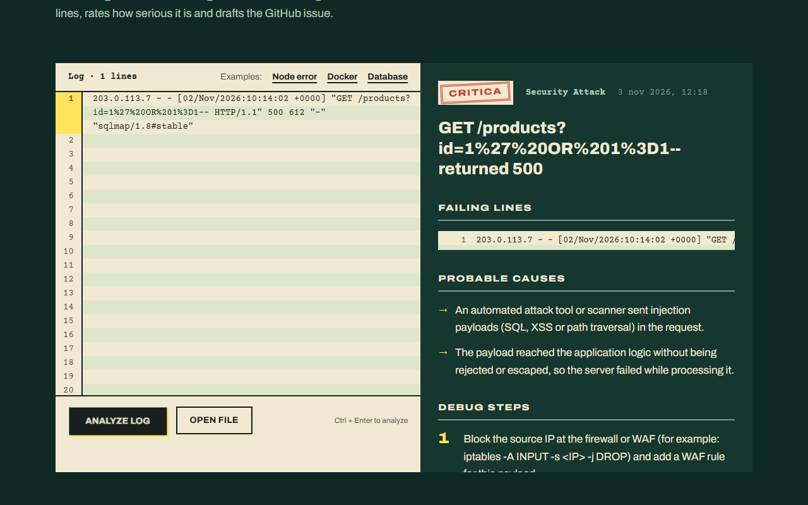
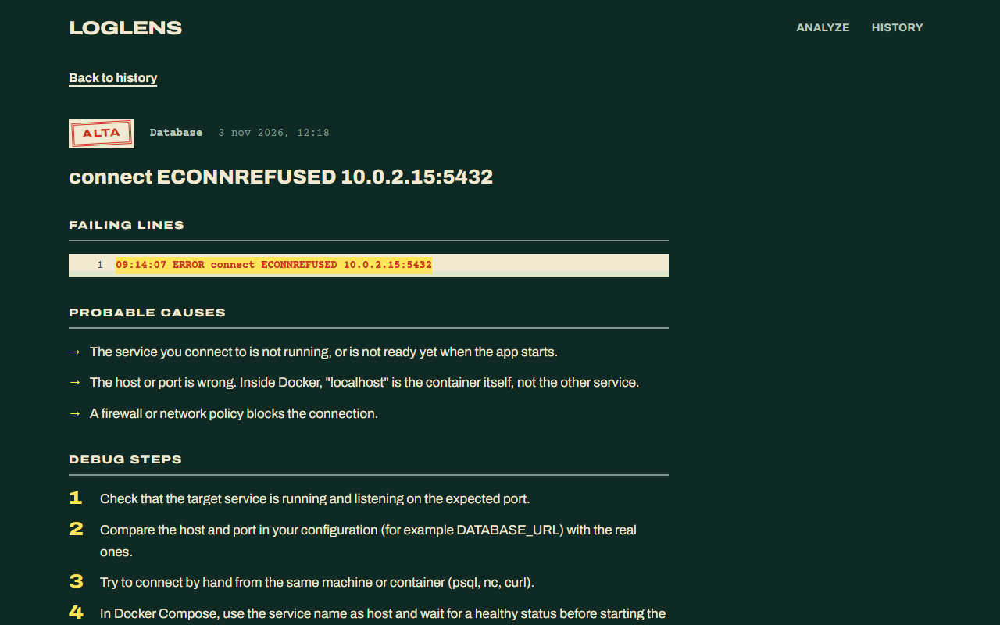
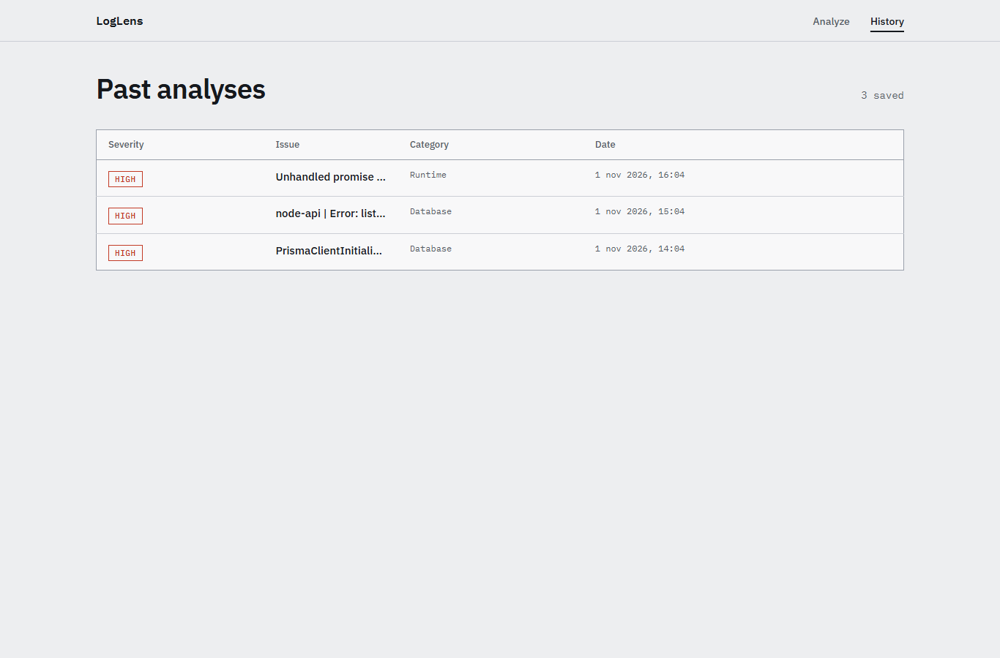

<div align="center">

# LogLens

**Paste a log or a stack trace — get an AI-powered analysis and a ready-to-paste bug report.**

LogLens reads your logs, finds the real error, classifies its severity and
category, explains the likely causes, suggests debugging steps, and generates a
GitHub Issue you can copy in one click.

[](https://github.com/jacknegri89/LogLens/actions/workflows/ci.yml)


</div>

**Live demo:** https://loglens-demo.vercel.app

---

## Features

- **Paste or upload** — paste a log/stack trace or drop a `.txt` / `.log` file
- **AI analysis** — the relevant lines are sent to an AI model that returns a structured report
- **Severity & category** — every issue is classified (low / medium / high) and tagged
- **Actionable report** — main problem, key log lines, probable causes, debug steps
- **Copy-ready GitHub Issue** — one click to copy a formatted bug report
- **History** — every analysis is saved; revisit it from a detail page
- **Pluggable AI** — works with **OpenAI** or a **free local Ollama** model

## Tech stack

| Area     | Technology                        |
| -------- | --------------------------------- |
| Frontend | React, TypeScript, Vite, Tailwind |
| Backend  | Node.js, Express, TypeScript      |
| Database | PostgreSQL via Supabase (Prisma)  |
| AI       | OpenAI API **or** Ollama (local)  |
| Tests    | Vitest                            |
| CI/CD    | GitHub Actions                    |

## Architecture

The flow in one line: **client → API → parser → AI provider → database → report**.

Full diagram and design decisions in [`docs/architecture.md`](./docs/architecture.md).
Prompt design lives in [`docs/prompts.md`](./docs/prompts.md).

## Getting started

### Prerequisites

- Node.js `>= 20`
- An OpenAI API key **or** a local [Ollama](https://ollama.com) install

### Setup

```bash
git clone https://github.com/jacknegri89/LogLens.git
cd LogLens
```

### Run the backend

```bash
cd server
npm install
cp .env.example .env
# Edit .env: paste your Supabase (or any PostgreSQL) DATABASE_URL
npm run prisma:migrate      # push schema to DB + seed example data
npm run dev                 # starts http://localhost:3001 with auto-reload
```

Check it's alive:

```bash
curl http://localhost:3001/api/health
# { "status": "ok", "service": "loglens-server", "timestamp": "..." }
```

### Run the frontend

```bash
cd client
npm install
npm run dev                 # starts http://localhost:5173
```

Open the app at `http://localhost:5173`. The frontend expects the backend running at `http://localhost:3001`.

## Project structure

```text
LogLens/
├── client/     # React + TypeScript + Vite + Tailwind CSS frontend
├── server/     # Node.js + Express + TypeScript backend
│   └── prisma/ # schema.prisma, migrations, seed
├── docs/       # architecture notes, AI prompt design
├── examples/   # sample log files to try the app with
└── .github/    # CI workflow
```

## Screenshots

> Captured on the live demo, which uses `AI_PROVIDER=rules` (built-in rules, no API key).

| Paste a log or upload a file                  | Report with severity, key lines, causes and steps |
| --------------------------------------------- | ------------------------------------------------- |
|  |             |



## Deploy on Vercel

The whole app (React client + Express API) runs as one Vercel project, with
PostgreSQL on Supabase. Both have a free tier.

1. **Database.** Create a project on [supabase.com](https://supabase.com), then copy the
   two connection strings (Settings → Database): the _transaction pooler_ (port 6543) and
   the _session pooler_ (port 5432).
2. **Create the tables once**, from your computer:

   ```bash
   cd server
   cp .env.example .env     # paste DATABASE_URL and DIRECT_URL
   npm run prisma:migrate
   ```

3. **Import the repo** on [vercel.com](https://vercel.com) → _Add New → Project_.
   Leave the build settings alone: `vercel.json` already contains them.
4. **Environment variables** (Project → Settings → Environment Variables):

   | Variable         | Value                                             |
   | ---------------- | ------------------------------------------------- |
   | `DATABASE_URL`   | Supabase transaction pooler URI                   |
   | `DIRECT_URL`     | Supabase session pooler URI                       |
   | `AI_PROVIDER`    | `mock`, or `openai`                               |
   | `OPENAI_API_KEY` | your key (only when `AI_PROVIDER=openai`)         |
   | `CORS_ORIGIN`    | leave empty: client and API share the same domain |

5. **Deploy.** `npm run build:vercel` builds the client and bundles the API into
   `.vercel/output` (see `server/scripts/build-vercel.mjs`).

> Note: the history page lists every saved analysis, so on a public demo anyone can see
> what other visitors pasted. Do not paste real secrets into a public instance.

## Examples

Try LogLens with the sample logs in [`examples/`](./examples/):

- [`node-error.log`](./examples/node-error.log) — a Node.js unhandled exception
- [`docker-error.log`](./examples/docker-error.log) — a Docker Compose startup failure
- [`database-error.log`](./examples/database-error.log) — database connection & query errors

## Roadmap

- [x] **Phase 0** — Project structure, CI skeleton, docs & examples
- [x] **Phase 1** — Express + TypeScript backend
- [x] **Phase 2** — Prisma schema & migrations
- [x] **Phase 3** — Log parser
- [x] **Phase 4** — AI analysis service (OpenAI / Ollama)
- [x] **Phase 5** — Analysis API endpoints
- [x] **Phase 6** — React + Tailwind frontend
- [x] **Phase 7** — Tests (Vitest)
- [x] **Phase 8** — Full CI/CD
- [x] **Phase 9** — Screenshots, polish & docs

## License

No open-source license — all rights reserved © 2026 Giacomo Negri.
You're welcome to browse the code; please ask before reusing it.
