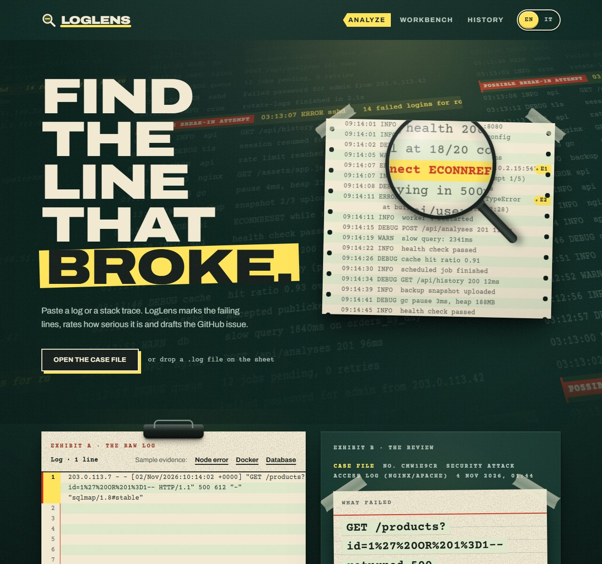
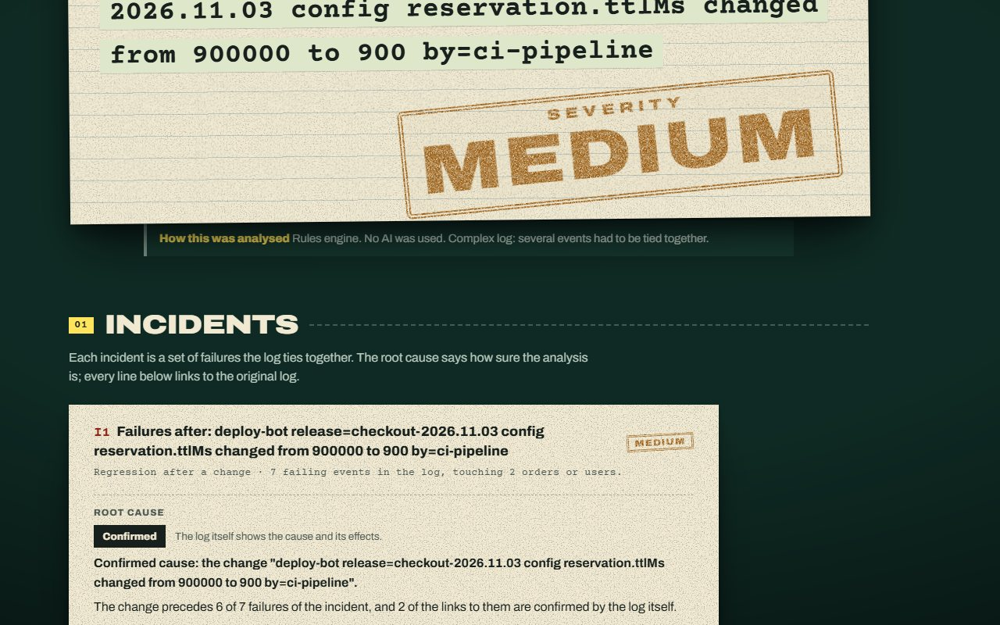
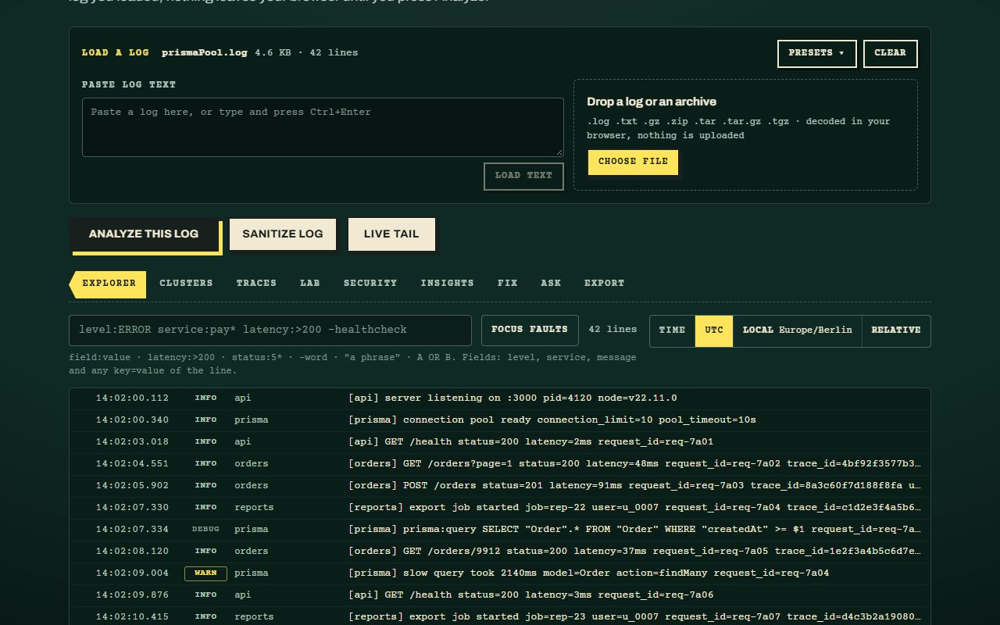
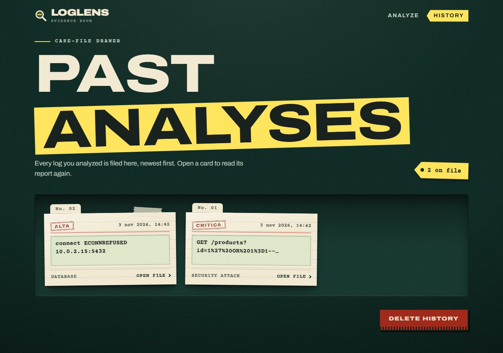
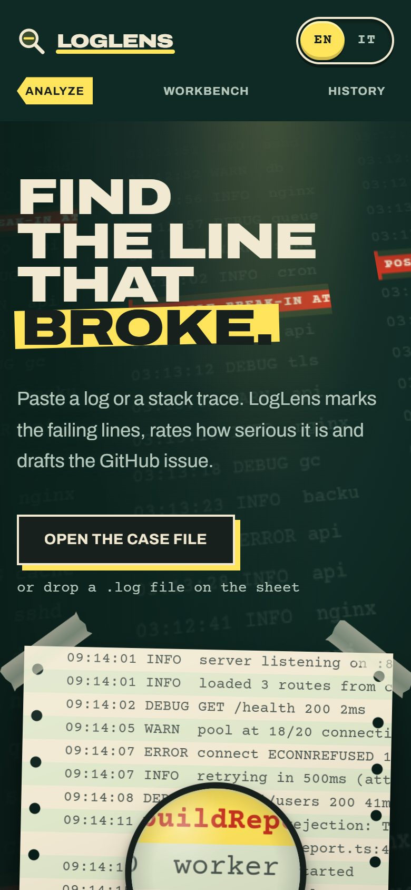
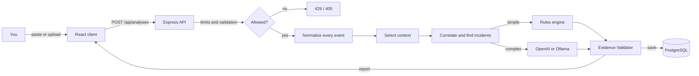

<div align="center">


# LogLens

**Find the line that broke.**

Paste a log or a stack trace. LogLens marks the failing lines, rates how serious the problem is,
explains the probable causes and drafts the GitHub issue, ready to copy.

[**Live demo**](https://loglens-demo.vercel.app) ·
[Italiano](./README.it.md) ·
[Architecture](./docs/architecture.md) ·
[Changelog](./docs/changelog.md)

[](https://github.com/jacknegri89/LogLens/actions/workflows/ci.yml)
[](./LICENSE)




</div>

## Contents

- [What it does](#what-it-does)
- [See it](#see-it)
- [How it works](#how-it-works)
- [Quick start](#quick-start)
- [Configuration](#configuration)
- [API](#api)
- [Project structure](#project-structure)
- [Quality checks](#quality-checks)
- [Deploy on Vercel](#deploy-on-vercel)
- [Security and privacy](#security-and-privacy)
- [Status and limits](#status-and-limits)
- [Documentation](#documentation)
- [License](#license)

## What it does

LogLens turns a wall of log text into an answer you can act on.

**Analysis**

- Paste a log or stack trace, or drop a `.txt` / `.log` file. The format is detected on its own: syslog, JSON lines, Node.js errors, Python tracebacks, Java stack traces, Docker and Kubernetes, PostgreSQL, nginx and Apache access logs, Windows events.
- **Every event is read, nothing is thrown away blindly.** Mixed formats in one file, stack traces kept whole, time zones and out-of-order lines handled. Routine noise (health checks, probes, static assets) is set aside but counted; events around a failure, deployments, configuration changes and payments are kept as context.
- **Incidents with a root cause.** The failures a log ties together become one incident each; independent problems stay separate. A root cause is **confirmed** only when the log itself shows it, otherwise **probable**, an **unverified hypothesis** or **insufficient information**. Every claim points at the original log line.
- Every problem gets a **severity** (informational to critical) and a **category**, probable **causes** and **debug steps**.
- Related events are linked: root cause first, then what it set off, in time order. Repeated failed logins from one address followed by a success are flagged as a possible brute-force break-in.
- A **GitHub issue** is drafted for you, formatted and ready to copy.
- A built-in **rules engine** (50+ rules) works with no API key and no network. In `hybrid` mode **OpenAI** reasons about complex incidents (several services, a change before the failures, an unsettled cause) and about logs no rule covers; simple ones stay with the rules. **Ollama** runs a local model for free. Every report says which engine wrote it, and that no AI was used when none was.
- The page and the reports speak **English and Italian**.

**Keep and share**

- Each analysis is saved in a history that only its owner can see, and kept for 90 days. A copy stays in the browser, so the history still opens when the server is down.
- Share a report with a secret, read-only link. The original log is never included, secrets and e-mail addresses in the report text are masked when the link is opened, and the link can be revoked at any time.
- Mark a report useful or not useful.

**Workbench**: a set of tools that work on a log without leaving your browser.

- **Explorer** with a small query language (`level:ERROR service:pay* latency:>200 -healthcheck`), a virtual list that stays smooth on very large logs, and `.gz`, `.zip` and `.tar` archives opened locally.
- **Clusters** that group similar lines, **Traces** that follow one request across services.
- **Lab**: a regex tester that cannot freeze the page, a log diff, a source-map reader and a live tail.
- **Security**: a scanner for suspicious patterns and a scrubber that hides sensitive data.
- **Insights**: risk score, flame graph and a map of the services involved.
- **Export** as a GitHub issue, a Slack message, a PagerDuty event, a post-mortem or JSON, plus permalinks. A command palette (`Ctrl K`) reaches everything.

## See it

<table>
  <tr>
    <td width="50%"></td>
    <td width="50%"></td>
  </tr>
  <tr>
    <td align="center"><sub><b>The report</b>: what failed, how serious it is, and the evidence behind it.</sub></td>
    <td align="center"><sub><b>The Workbench</b>: search, group and inspect a log in the browser.</sub></td>
  </tr>
  <tr>
    <td width="50%"></td>
    <td width="50%" align="center"></td>
  </tr>
  <tr>
    <td align="center"><sub><b>History</b>: every analysis of the last 90 days, only yours.</sub></td>
    <td align="center"><sub><b>On a phone</b>: the same pages, laid out for a small screen.</sub></td>
  </tr>
</table>

> Screenshots come from the live demo, which runs with `AI_PROVIDER=hybrid`: the built-in rules answer first, and OpenAI only handles logs no rule covers.

## How it works



1. **Normalize.** Every record of the log becomes an event (time with its confidence, level, service, identifiers, stack trace, original lines). A line that cannot be parsed is kept, not dropped.
2. **Select context.** Failures, changes, state transitions, events that share an identifier with a failure and the events around them are kept; routine traffic is counted, not read. Large logs are scanned in overlapping chunks, and if a limit cuts anything the report says the analysis is partial.
3. **Correlate.** Events are linked only by evidence: a shared identifier, a changed value that later failures report, a dependency the log names. Time alone is never a link. Each link has a certainty and the reasons it might be wrong.
4. **Incidents and root cause.** Linked failures form incidents; each gets hypotheses, checked against the evidence and against what contradicts them.
5. **Engine.** Simple incidents go to the **rules engine**. A **complex** incident goes to the model even when a rule matches; the model judges the incidents it is given (it never creates them), within a call, cost and time budget. If the model is unavailable the rules answer and the report says why.
6. **Evidence Validator.** Every event id, line, quote, order, amount and time in the report is checked against the log; unsupported claims are removed, risky commands get a warning. A model can lower the certainty of a root cause freely, but it can raise it only when it cites events of that incident that the correlation ties to its failures: citing events that merely exist proves nothing. The title, causes, steps and issue text a model writes are checked the same way, and shown as hypotheses when no incident has a supported cause. Secrets are masked before any text goes to an external provider.
7. The report is validated with Zod, saved with Prisma and returned.

The prompt, its four phases and its protection against prompt injection are described in [`docs/prompts.md`](./docs/prompts.md). The full design is in [`docs/architecture.md`](./docs/architecture.md). The analysis engine is measured against 15 realistic logs with known answers, with no paid API: see [`docs/benchmarks.md`](./docs/benchmarks.md) (`npm run benchmark` in `server/`).

## Quick start

**You need:** Node.js 20 or newer and a PostgreSQL database (free on [Neon](https://neon.tech) or [Supabase](https://supabase.com)). An OpenAI key or [Ollama](https://ollama.com) is optional: the rules engine needs neither.

```bash
git clone https://github.com/jacknegri89/LogLens.git
cd LogLens
```

**Backend** (http://localhost:3001)

```bash
cd server
npm install                 # also generates the Prisma client
cp .env.example .env        # then fill in DATABASE_URL and DIRECT_URL
npm run prisma:migrate      # creates the tables: review the changes and back up existing data first
npm run db:seed             # optional: example analyses, only if the table is empty
npm run dev                 # starts with auto-reload
```

```bash
curl http://localhost:3001/api/health
# { "status": "ok", "service": "loglens-server", "timestamp": "..." }
```

**Frontend** (http://localhost:5173)

```bash
cd client
npm install
npm run dev
```

Open http://localhost:5173. The client expects the API on port 3001.

Try it with the logs in [`examples/`](./examples/): a Node.js unhandled exception, a Docker Compose startup failure and database connection errors.

## Configuration

Everything is configured with environment variables, validated at startup (a wrong value stops the server with a clear message). Locally they live in `server/.env`; on Vercel, in the project settings. Secrets never go in the code or in git.

| Variable                                                               | Default                   | What it does                                                                                                                            |
| ---------------------------------------------------------------------- | ------------------------- | --------------------------------------------------------------------------------------------------------------------------------------- |
| `DATABASE_URL`                                                         | (required)                | Pooled PostgreSQL connection, used by the app                                                                                           |
| `DIRECT_URL`                                                           | (required for migrations) | Direct connection, used by the Prisma CLI                                                                                               |
| `AI_PROVIDER`                                                          | `mock`                    | `mock`, `rules`, `hybrid`, `openai` or `ollama`. **Production refuses to start without it, and refuses `mock`**                         |
| `ALLOW_MOCK_PROVIDER`                                                  | `false`                   | `true` lets production use `mock` on purpose (canned text, not an analysis)                                                             |
| `OPENAI_API_KEY`                                                       |                           | Needed for `openai` and `hybrid`                                                                                                        |
| `OPENAI_MODEL`                                                         | `gpt-4o-mini`             | The OpenAI model                                                                                                                        |
| `OLLAMA_BASE_URL`                                                      | `http://localhost:11434`  | Where Ollama listens                                                                                                                    |
| `OLLAMA_MODEL`                                                         | `llama3.2`                | The Ollama model                                                                                                                        |
| `RATE_LIMIT_PER_HOUR`                                                  | `5`                       | Analysis attempts per address per hour, failed ones included (`0` = no limit)                                                           |
| `GLOBAL_LIMIT_PER_HOUR`                                                | `100`                     | Analysis attempts for everyone per hour (`0` = no limit)                                                                                |
| `API_RATE_LIMIT_PER_MINUTE`                                            | `120`                     | Requests per minute from one address to the whole API, counted per instance (`0` = no limit)                                            |
| `TRUST_PROXY`                                                          | `false`                   | `true` behind a proxy such as Vercel, so limits count real visitors                                                                     |
| `VISITOR_SALT`                                                         | `loglens`                 | A random text (16+ characters) that salts the hash of visitor addresses. **Production refuses the default and weak values**             |
| `CRON_SECRET`                                                          |                           | 16+ characters; Vercel Cron sends it to clean up analyses older than 90 days                                                            |
| `CORS_ORIGIN`                                                          | `*`                       | Allowed origin, written as `https://app.example.com`. In production leave it empty or `*`: the API then answers same-site requests only |
| `ANALYSIS_MAX_SELECTED_EVENTS`                                         | `1500`                    | Most events kept for the analysis; more and the report says it is partial                                                               |
| `AI_CONTEXT_MAX_CHARS`                                                 | `24000`                   | Most characters of log context sent to a model                                                                                          |
| `AI_CONTEXT_MAX_EVENTS`                                                | `250`                     | Most events sent to a model                                                                                                             |
| `AI_MAX_CALLS_PER_ANALYSIS`                                            | `1`                       | Model calls per analysis (`0` = never call a model)                                                                                     |
| `AI_MAX_COST_USD_PER_ANALYSIS`                                         | `0.05`                    | Estimated cost above which the model is not called (the rules answer instead)                                                           |
| `AI_INPUT_USD_PER_MILLION_TOKENS` / `AI_OUTPUT_USD_PER_MILLION_TOKENS` | `0.15` / `0.6`            | Prices used for that estimate: set them for your model                                                                                  |
| `AI_TIMEOUT_MS`                                                        | `40000`                   | How long a model call may take before the rules answer instead                                                                          |

## API

| Method   | Path                         | What it does                                                     |
| -------- | ---------------------------- | ---------------------------------------------------------------- |
| `POST`   | `/api/analyses`              | Analyze a log and save the report                                |
| `GET`    | `/api/analyses`              | The history of this visitor                                      |
| `GET`    | `/api/analyses/:id`          | One analysis with its full report                                |
| `DELETE` | `/api/analyses/:id`          | Delete one analysis (`DELETE /api/analyses` deletes them all)    |
| `PUT`    | `/api/analyses/:id/feedback` | Mark useful, not useful, or clear                                |
| `POST`   | `/api/analyses/:id/share`    | Create the secret read-only link (`DELETE` revokes it)           |
| `GET`    | `/api/shared/:token`         | The shared report, without the raw log                           |
| `GET`    | `/api/cron/retention`        | Delete analyses older than 90 days (Vercel Cron, needs a secret) |
| `GET`    | `/api/health`                | Liveness check                                                   |

`/api/analyses` routes need an `X-Visitor-Id` header: a random id the browser keeps, not a login. Details, bodies and the code map are in [`server/README.md`](./server/README.md).

## Project structure

```text
LogLens/
├── client/               # React + TypeScript + Vite + Tailwind
│   ├── src/pages/        # analyze, history, report, shared link, privacy
│   ├── src/content/      # every visible text, in English and Italian
│   ├── src/workbench/    # the Workbench, one folder per tab
│   └── e2e/              # Playwright end-to-end tests
├── server/               # Node.js + Express + TypeScript
│   ├── src/routes/       # the /api routes
│   ├── src/parser/       # every format → normalized events (time, ids, stack traces)
│   ├── src/analysis/     # context selection, correlation, incidents, root cause
│   ├── src/ai/           # rules engine, OpenAI / Ollama, prompt, budget, Evidence Validator
│   ├── benchmarks/       # realistic logs with known answers, metrics, `npm run benchmark`
│   ├── src/services/     # limits, retention, saving analyses
│   └── prisma/           # schema and seed data
├── docs/                 # architecture, prompts, decisions, status, changelog
├── examples/             # sample logs to try
├── vercel.json           # build command and the daily cron
└── .github/workflows/    # CI
```

## Quality checks

```bash
npm run format:check                 # Prettier, from the repository root
npm run typecheck --prefix server
npm run typecheck --prefix client
npm run lint                         # client and server
npm audit --audit-level=moderate     # also in server/ and client/
npm test --prefix server             # unit, API and regression tests, benchmarks
npm test --prefix client             # unit tests
npm run test:e2e --prefix client     # Playwright, phone viewport
```

The same checks, plus the builds (including the Vercel bundle), run on every push in [GitHub Actions](./.github/workflows/ci.yml). Dependencies are audited with `npm audit` and kept at zero known vulnerabilities.

## Deploy on Vercel

The whole app (React client and Express API) runs as one Vercel project, with PostgreSQL on Neon through the Vercel integration. Both have a free tier.

1. **Import the repository** on [vercel.com](https://vercel.com) → _Add New → Project_. Leave the build settings alone: `vercel.json` has them.
2. **Add the database**: in _Storage_ add **Neon**. Vercel creates `DATABASE_URL` and `DIRECT_URL`.
3. **Add the environment variables** from [Configuration](#configuration). On Vercel set at least `AI_PROVIDER`, `TRUST_PROXY=true`, a long random `VISITOR_SALT`, and `CRON_SECRET`. Add `OPENAI_API_KEY` for `openai` or `hybrid`.
4. **Create the tables once**, from your computer, with the Neon URLs in `server/.env`: `cd server && npm run prisma:migrate`.
5. **Deploy**: push to the connected branch, or run `npm run build:vercel` and deploy `.vercel/output`.

Vercel Cron calls `/api/cron/retention` every day at 03:00 UTC (see `vercel.json`).

If you run your own instance, update the contact, the database region and the providers in [`client/src/content/privacy.ts`](./client/src/content/privacy.ts), and keep its 90 days equal to `ANALYSIS_RETENTION_DAYS` in `server/src/services/retention.ts`.

## Security and privacy

- **No cookies.** The browser's local storage keeps only your choices (language, anonymize, theme), a random visitor id and a local copy of your history. The [privacy page](https://loglens-demo.vercel.app/privacy) lists what is handled, why and for how long.
- **Where your log goes.** The analysis always runs on the LogLens server, in every mode: pressing Analyze sends the log there and stores it with the report (the server is the one you deploy, with a database you choose). Only the **Anonymize** switch and the Workbench views work in your browser alone. Beyond the server, a log reaches a third party only when you choose `openai` or `hybrid` (OpenAI) or point `OLLAMA_BASE_URL` at another machine.
- **Anonymize before sending.** One switch replaces IP addresses, e-mails and secrets in your browser, before anything leaves it.
- **Data limits.** Analyses are deleted after 90 days, or earlier by you. Network addresses are stored only as salted hashes, and the attempts that use them are removed after an hour.
- **Share links** carry an unguessable token, never reach the logs, are sent with `Referrer-Policy: no-referrer`, are not cached or indexed, and can be revoked. The shared report has every secret and e-mail address masked, at every level of the report, each time the link is opened.
- **Abuse limits.** Per-address and global hourly limits on analyses, checked and recorded in one locked database transaction so requests that arrive together cannot pass the last free place, and a per-minute limit on the whole API.
- **Hardened responses.** A strict Content-Security-Policy, `X-Frame-Options`, `nosniff`, HSTS and a locked-down Permissions-Policy on every response.
- **Model output is untrusted.** It is validated, checked against the log it came from, stripped of links and HTML, and the prompt uses a random delimiter against prompt injection.
- **The log is untrusted too.** A line that tries to give orders to the analyser is reported and not obeyed. What a model receives is a structured summary of the events (message, level, time, service and identifiers), not the raw file. Tokens, passwords, keys, cookies and connection strings are masked in it, session ids are replaced by stable pseudonyms (`session-1`), and the masking runs once more right before the request leaves. Request, trace and order ids are kept, because a model cannot follow a story without them. In `rules` mode, and in `ollama` mode with a local model, no log leaves your machine.
- **Cleanup endpoint.** `GET /api/cron/retention` refuses any call without the `CRON_SECRET`, compared in constant time.

Even so, do not paste real secrets into a public instance.

## Status and limits

- Correlation proves what the log shows: when two services never share an identifier and never name each other, their failures stay separate incidents even if a person would link them. The root cause is then **probable** or **insufficient**, never forced.
- Reports with incidents no longer show the earlier summary and findings list; the evidence board is drawn from the incidents. Older reports keep their original view.
- The model path has been tested only with stand-in providers. `npm run benchmark:live -- --yes` runs it with your own key (a few cents).
- The **Fix** and **Ask** tabs of the Workbench show "not available yet". Their code is in the repository but unreachable until it is reviewed.
- `X-Visitor-Id` is not a login. It works like a session cookie: whoever holds the id can read and delete that history, and a guessable id is refused. It keeps histories apart in a demo without accounts; it does not protect sensitive logs.
- A database error answers `503`, not `500`, and the server log never contains the data of a failed query.
- The hourly-limit transaction is tested against a stand-in database that interleaves requests; it has not been run against a real PostgreSQL yet.
- The per-minute API limit is counted in each server instance's memory: it stops bursts, but it is not a global quota. The hourly analysis limits are in the database and are shared.
- The daily cleanup runs on Vercel's schedule; analyses past 90 days are also removed on the next history read or new analysis.

See [`docs/stato.md`](./docs/stato.md) for the current status and [`docs/decisions.md`](./docs/decisions.md) for why things are the way they are.

## Documentation

| File                                             | What is in it                                   |
| ------------------------------------------------ | ----------------------------------------------- |
| [`docs/architecture.md`](./docs/architecture.md) | The flow, the components and the design choices |
| [`docs/prompts.md`](./docs/prompts.md)           | The prompt, its phases and the JSON contract    |
| [`docs/decisions.md`](./docs/decisions.md)       | Decisions, with the reason and the alternatives |
| [`docs/changelog.md`](./docs/changelog.md)       | What changed and when                           |
| [`docs/stato.md`](./docs/stato.md)               | Current status and what is left                 |
| [`docs/checklist.md`](./docs/checklist.md)       | The latest end-of-task checks, PASS or FAIL     |
| [`server/README.md`](./server/README.md)         | The backend: scripts, structure and API details |

Issues and pull requests are welcome. Run the [quality checks](#quality-checks) first.

## License

Released under the [MIT License](./LICENSE) © 2026 Giacomo Negri.
