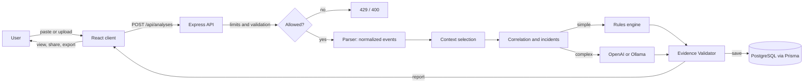

# Architecture

LogLens is a small full-stack application with a clear split between the **frontend** (what the
user sees), the **backend** (parsing, limits, storage) and the **analysis engine** (rules, and a
model when the rules do not cover a log).

## High-level overview



## Components

| Layer       | Tech                          | Responsibility                                                           |
| ----------- | ----------------------------- | ------------------------------------------------------------------------ |
| Client      | React + TypeScript + Tailwind | Input, report, history, sharing, the Workbench, English and Italian      |
| API         | Node.js + Express + TS        | Validate input, apply limits, orchestrate analysis, persist, expose REST |
| Parser      | Pure TS functions             | Split the log into records, read every format into normalized events     |
| Analysis    | Pure TS functions             | Select context, correlate events, build incidents and root causes        |
| Rules       | TS tables and matchers        | Recognise known failures and write the report without a network call     |
| AI provider | OpenAI **or** Ollama          | Write the report for logs no rule covers, behind one interface           |
| Guard       | Pure TS functions             | Check any model output against the log it came from                      |
| Validator   | Pure TS functions             | Evidence Validator: ids, lines, quotes, values and certainty vs the log  |
| Legacy      | Pure TS functions             | The earlier keyword excerpt, findings and overview, still in the report  |
| Database    | PostgreSQL (Prisma 7)         | Analyses and analysis attempts                                           |
| Hosting     | Vercel + Neon                 | One project for the client and the API, a daily cron for retention       |

## Request lifecycle (analyze a log)

1. The user pastes a log or uploads a file. With **Anonymize** on, IP addresses, e-mails and
   secrets are replaced in the browser first.
2. The client sends the text to `POST /api/analyses` with the visitor id. The API checks the
   per-minute limit, validates the body and reserves an attempt against the hourly limits.
3. The analysis runs ([the engine](#the-analysis-engine) below), and the report is validated with
   Zod, saved with Prisma and returned. The client shows it, keeps a local copy and offers
   sharing, feedback and export.

## The analysis engine

`services/analysisService.ts` runs the stages in order. Stages 1 to 4 are deterministic: the same
log gives the same incidents, at no cost and with no network call.

1. **Normalize** (`parser/`). `recordSplitter` groups lines into logical records (a stack trace
   stays with its headline); a parser per format (JSON lines, syslog 3164/5424, nginx and Apache
   access and error logs, Docker/Kubernetes, Node, Python and Java traces, PostgreSQL, MySQL,
   systemd, Windows events, generic application logs) turns each record into a
   `NormalizedLogEvent`: time with a confidence (`exact`, `assumed`, `partial`, `none`), level,
   service, host, identifiers (trace, span, request, session, user, order, deployment...), status,
   attributes, original line range and the raw text. A line that cannot be read becomes an
   `unparsed` event. Mixed formats in one file are detected per record.
2. **Select context** (`analysis/contextSelection.ts`). Failures, changes, state transitions, events
   that share an identifier with a failure and the events around them are kept; routine traffic is
   counted. The scan is chunked with overlap, never cuts a stack trace, and honours a budget. The
   result carries a **coverage** record (events read, ignored routine, not selected, cut by the
   budget, not acquired) and says when the analysis is partial.
3. **Correlate** (`analysis/eventCorrelation.ts`). Events are ordered by time (with the basis of
   each position: exact, assumed, inferred from the file), grouped by shared identifiers, and linked.
   A link is `same-identifier`, `change-precedes-anomaly`, `dependency-failure`, `entity-sequence`
   or `known-relation`, with a certainty (`confirmed`, `probable`, `possible`), the evidence lines
   and the reasons it might be wrong. Rules: a shared identifier is evidence; **time is a hint,
   never a proof**; a shared IP or category is not a link; links only go forward in time, so the
   graph has no cycles.
4. **Incidents and root cause** (`analysis/incidents.ts`, `rootCause.ts`). Failures joined by links of
   at least probable certainty, shared identifiers or being the same recurring failure (same text, or
   the same known kind of failure such as failed logins) form one incident; independent problems stay
   separate. A log with no identifiers has nothing else to go on, so consecutive failures of one place
   within a second are grouped, and the incident says it was grouped by time only (never a causal claim). Hypotheses (a change, a failing dependency, an
   exception, an attack) are checked against the links and against earlier failures of the same
   kind. Status: `confirmed` (the log itself shows cause and effects, nothing contradicts),
   `probable`, `unverified`, `insufficient`. Severity comes from impact, spread, availability,
   integrity and security (`incidentImpact.ts`); one HTTP 500 is medium and an attack attempt is
   never a compromise.
5. **Engine** (`ai/providers/hybridProvider.ts`, `analysis/complexity.ts`). The complexity of the
   incidents decides who writes the analysis. In `hybrid` mode a **complex** incident (several
   services, a change before the failures, a cause not settled, competing hypotheses, a partial
   analysis) goes to the model even when a known rule matches; a log with no incident, or a simple
   one with a known rule, stays with the rules. Before a call the budget is checked
   (`ai/aiBudget.ts`: context size, calls, estimated cost, timeout). If the model fails or the
   budget refuses, the rules answer and the report carries `engine.fallbackReason`. `engine.aiUsed`
   is true only when a model's answer was used.
6. **Model input** (`ai/structuredContext.ts`, `ai/prompt.ts`). The model gets a JSON document of
   events (ids, original lines, identifiers, time basis), links with certainty and uncertainty,
   groups and the incidents with a **candidate** root cause that it must verify. It returns an
   assessment for each incident id; it never creates incidents. Every piece of text from the log
   is masked first (`analysis/masking.ts`) whichever field it sits in; session ids become stable
   pseudonyms (`session-1`) and request, trace and order ids stay. The size limit
   (`AI_CONTEXT_MAX_CHARS`) applies to the whole JSON document: the largest number of events that
   fits is sent, incident failures and supposed causes first, and each incident says how many of its
   failures were left out. The providers mask the input once more right before the request
   (`ai/maskInput.ts`).
7. **Evidence Validator** (`ai/evidenceValidator.ts`, `ai/incidentReport.ts`). The model's
   assessment is merged only after checks: cited event ids must exist and their lines and quotes are
   rebuilt from the log; sentences naming an order, amount, time or event that is not in the log
   are removed; `confirmed` is allowed only when the engine confirmed; a claim with no valid evidence
   falls to `insufficient`; a command piped into a shell is dropped and a destructive one gets a
   warning. Every correction is listed in `report.validation`.

The report (`types/report.ts`) keeps the earlier fields and adds `incidents[]` (root cause with
status and evidence, confidence with measurable criteria, a full timeline, secondary symptoms,
observed against potential impact, immediate actions, permanent fix, preventive measures),
`engine`, `coverage`, `validation` and `promptInjection`. Stored reports are JSON, so no migration
is needed; reports made before this change simply have none of the new fields.

**The log is untrusted.** A line that tries to instruct the analyser (`analysis/promptInjection.ts`)
is reported and kept out of the incidents; the prompt separates instructions from data with a random
boundary; nothing the log or the model says is ever executed.

## Retention and cleanup

- Analyses are deleted 90 days after they are saved. The cleanup runs on `GET /api/analyses`,
  on `POST /api/analyses`, and once a day from Vercel Cron (`GET /api/cron/retention`, which
  needs the `CRON_SECRET`).
- Analysis attempts, which hold a salted hash of the visitor's address, are deleted after one
  hour, when they stop counting towards the limits: by the transaction that records a new attempt
  and by the daily job.
- A report stored in the database is read through `analysis/storedReport.ts`: a damaged or old
  row gives a smaller report, never an error.

## Sharing a report

`GET /api/shared/:token` returns the report of the link with every string passed through
`analysis/sanitizeReport.ts` (secrets masked, e-mail addresses hidden) at every depth: incidents,
evidence quotes, titles, the Markdown. The cleaning runs when the link is opened, so reports saved
before it existed are cleaned too. The raw log, the owner and the address hash are never selected.
The response is sent with `Cache-Control: no-store`, `X-Robots-Tag: noindex` and
`Referrer-Policy: no-referrer`, and the analytics event of the page has the token removed.

## Page HTML and link previews

The client is a single-page app, but a crawler that does not run JavaScript (the ones of chat apps
and search engines) reads only the HTML it receives. So every page has its own HTML file, written
when the client is built: `plugins/socialPages.ts` fills `index.html` and writes `workbench.html`,
`privacy.html`, `history.html`, `analysis.html`, `shared.html` and `404.html`, each with its own
title, description, canonical address and Open Graph / Twitter tags
(`plugins/pageHead.ts`, from `content/pageMeta.ts`). `server/scripts/build-vercel.mjs` routes each
address to its file, answers unknown addresses with a real 404 and sends `X-Robots-Tag` on the
private pages. The preview image is `client/public/og-image.jpg` (1200 × 630), drawn from
`client/brand/og-image.html` by `npm run brand:render` in `client/`.

The private pages (history, one analysis, a shared report, 404) are `noindex` and have no
canonical address or `og:url`: the address of a shared report holds its token, which must not be
copied into metadata. A shared link therefore shows the same generic preview as any other page and
reveals nothing about the report.

## Hourly limits

`tryReserveAttempt` (in `analysisRepository.ts`) checks the per-client and the global limit and
records the attempt in one transaction that first takes a PostgreSQL advisory lock. Requests that
arrive together queue on the lock, so exactly the allowed number passes and a refused attempt is
never written. `attemptReservation.integration.test.ts` runs it against a real PostgreSQL with
concurrent connections (a service container in CI, any local database through
`TEST_DATABASE_URL`). The per-minute limit (`middleware/apiRateLimit.ts`) stays in each instance's memory,
with a hard cap on the addresses it remembers.

## Where the analysis runs

Every analysis, in every mode, runs on the server (`POST /api/analyses`). The browser itself only
does the **Anonymize** replacement before sending and the Workbench views. A third party sees data
only when `AI_PROVIDER` is `openai` or `hybrid` (OpenAI receives the masked structured context) or
when `OLLAMA_BASE_URL` points to another machine.

## Key design decisions

- **Rules for the simple, a model for the complex.** The rules answer simple incidents without a
  key or a network call. A model reasons about incidents whose shape the rules cannot judge, within
  a budget, which keeps the cost and the data that leaves the server small.
- **Prove, do not guess.** Links need evidence, root causes carry a status, and a deterministic
  validator checks every claim against the log. Nothing is forced to look certain.
- **Narrow before prompting.** The model never sees the whole file: the engine selects and
  correlates first. This is cheaper, faster and more accurate.
- **Structured output, then a guard.** The model must return JSON that matches a fixed schema,
  and the guard checks that JSON against the log, so the app relies on facts, not on prose.
- **One interface for providers.** `AIProvider` has `mock`, `rules`, `hybrid`, `openai` and
  `ollama` implementations selected with `AI_PROVIDER`. The rest of the app never imports a
  vendor SDK directly.
- **No accounts.** A random visitor id, kept in the browser, keeps each history separate. It is
  not a login: it works like a session cookie, so whoever holds it can read and delete that
  history, and ids too regular to be random are refused. The hash of the network address and the
  hourly limits protect the shared quota.
- **Privacy by default.** No cookies, hashed addresses, retention limits and a strict
  Content-Security-Policy. See [`decisions.md`](./decisions.md).

## Folder structure

```text
LogLens/
├── client/               # React + TypeScript + Vite + Tailwind
│   ├── src/pages/        # analyze, history, report, shared link, privacy
│   ├── src/content/      # every visible text, in English and Italian
│   ├── src/workbench/    # the Workbench, one folder per tab
│   ├── plugins/          # build step: one HTML file per page with its own link-preview tags
│   ├── brand/            # source of the social preview image (npm run brand:render)
│   └── e2e/              # Playwright end-to-end tests
├── server/               # Express + TypeScript
│   ├── src/routes/       # the /api routes
│   ├── src/parser/       # records, formats, normalized events
│   ├── src/analysis/     # context selection, correlation, incidents, root cause
│   ├── src/ai/           # rules, providers, prompt, budget, Evidence Validator
│   ├── benchmarks/       # scenarios with known answers and the evaluator
│   ├── src/services/     # limits, retention, saving analyses
│   └── prisma/           # schema.prisma and seed
├── docs/                 # architecture, prompts, decisions, benchmarks, screenshots
├── examples/             # sample logs to try the app with
├── vercel.json           # build command and the daily cron
└── .github/workflows/    # CI
```
