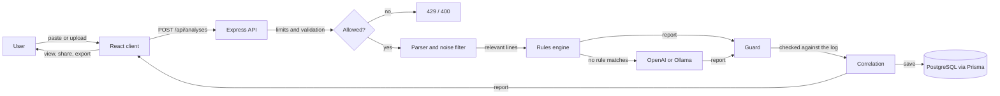

# Architecture

LogLens is a small full-stack application with a clear split between the **frontend** (what the
user sees), the **backend** (parsing, limits, storage) and the **analysis engine** (rules, and a
model when the rules do not cover a log).

## High-level overview



## Components

| Layer       | Tech                          | Responsibility                                                           |
| ----------- | ----------------------------- | ------------------------------------------------------------------------ |
| Client      | React + TypeScript + Tailwind | Input, report, history, sharing, the Workbench, English and Italian      |
| API         | Node.js + Express + TS        | Validate input, apply limits, orchestrate analysis, persist, expose REST |
| Parser      | Pure TS functions             | Detect the format, keep the relevant lines, drop routine noise           |
| Rules       | TS tables and matchers        | Recognise known failures and write the report without a network call     |
| AI provider | OpenAI **or** Ollama          | Write the report for logs no rule covers, behind one interface           |
| Guard       | Pure TS functions             | Check any model output against the log it came from                      |
| Correlation | Pure TS functions             | Link events: root cause, effects, shared addresses, a timeline           |
| Database    | PostgreSQL (Prisma 7)         | Analyses and analysis attempts                                           |
| Hosting     | Vercel + Neon                 | One project for the client and the API, a daily cron for retention       |

## Request lifecycle (analyze a log)

1. The user pastes a log or uploads a file. With **Anonymize** on, IP addresses, e-mails and
   secrets are replaced in the browser first.
2. The client sends the text to `POST /api/analyses` with the visitor id. The API checks the
   per-minute limit, validates the body and reserves an attempt against the hourly limits.
3. The **parser** detects the format and keeps the relevant lines (errors, warnings, exceptions,
   failures, timeouts, attacks, stack traces). The **noise filter** drops health checks, probes
   and static assets with a normal outcome, unless they carry an error.
4. The **rules engine** matches known failures. In `hybrid` mode a model is asked only when no
   rule applies; in `openai` and `ollama` mode it is asked for everything. The prompt is
   described in [`prompts.md`](./prompts.md).
5. The **guard** checks model output: severity cannot fall below the evidence, evidence lines
   must be real lines of the log, links and HTML are removed, risky commands are dropped.
6. **Correlation** adds the overview, the findings and the timeline to every report.
7. The API validates the report with Zod, saves it with Prisma and returns it. The client shows
   it, keeps a local copy and offers sharing, feedback and export.

## Retention and cleanup

- Analyses are deleted 90 days after they are saved. The cleanup runs on `GET /api/analyses`,
  on `POST /api/analyses`, and once a day from Vercel Cron (`GET /api/cron/retention`, which
  needs the `CRON_SECRET`).
- Analysis attempts, which hold a salted hash of the visitor's address, are deleted after one
  hour, when they stop counting towards the limits.

## Key design decisions

- **Rules first.** The built-in rules answer without a key or a network call. A model is a
  fallback for unknown logs, which keeps the cost and the data that leaves the server small.
- **Parse before prompting.** The model never sees the whole file: the parser narrows it down
  first. This is cheaper, faster and more accurate.
- **Structured output, then a guard.** The model must return JSON that matches a fixed schema,
  and the guard checks that JSON against the log, so the app relies on facts, not on prose.
- **One interface for providers.** `AIProvider` has `mock`, `rules`, `hybrid`, `openai` and
  `ollama` implementations selected with `AI_PROVIDER`. The rest of the app never imports a
  vendor SDK directly.
- **No accounts.** A random visitor id, kept in the browser, keeps each history separate. It is
  not a login, so the hash of the network address and hourly limits protect the shared quota.
- **Privacy by default.** No cookies, hashed addresses, retention limits and a strict
  Content-Security-Policy. See [`decisions.md`](./decisions.md).

## Folder structure

```text
LogLens/
├── client/               # React + TypeScript + Vite + Tailwind
│   ├── src/pages/        # analyze, history, report, shared link, privacy
│   ├── src/content/      # every visible text, in English and Italian
│   ├── src/workbench/    # the Workbench, one folder per tab
│   └── e2e/              # Playwright end-to-end tests
├── server/               # Express + TypeScript
│   ├── src/routes/       # the /api routes
│   ├── src/ai/           # parser output, rules, providers, guard, correlation
│   ├── src/services/     # limits, retention, saving analyses
│   └── prisma/           # schema.prisma and seed
├── docs/                 # architecture, prompts, decisions, status, changelog, screenshots
├── examples/             # sample logs to try the app with
├── vercel.json           # build command and the daily cron
└── .github/workflows/    # CI
```
